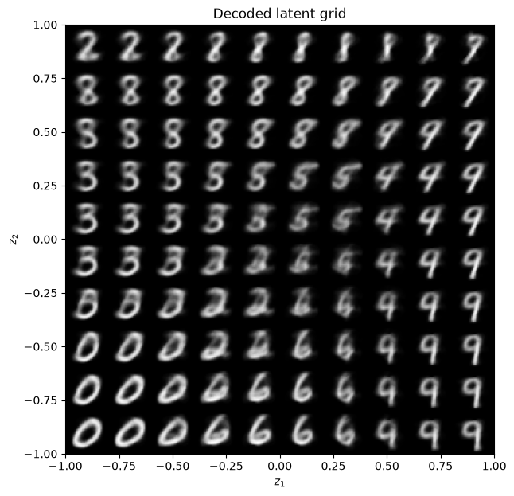
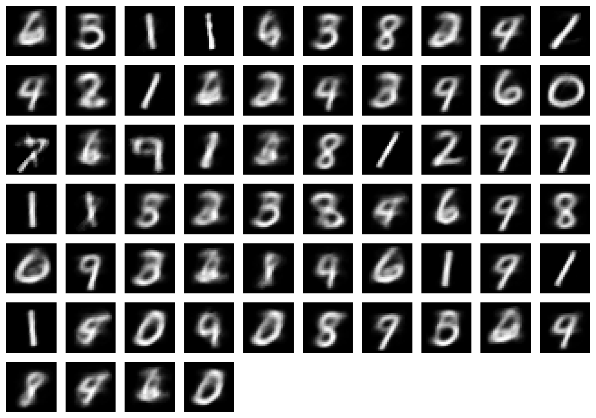
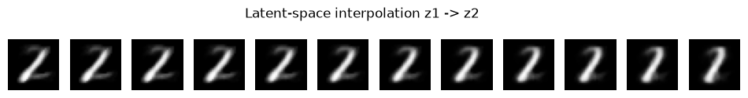
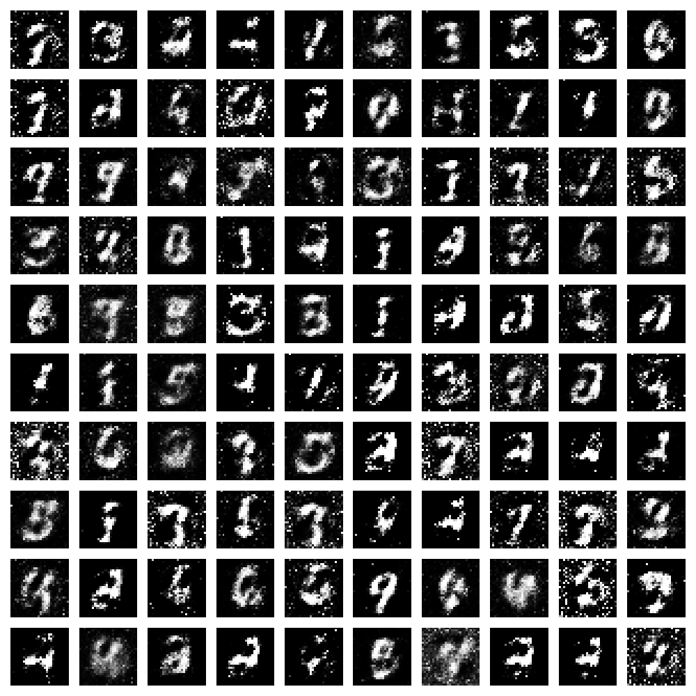

# Generative Models on MNIST

PyTorch notebooks from a graduate deep learning course: a Variational Autoencoder, a GAN, and an MLP classifier,
all trained on MNIST.

| Notebook | What it does | Result |
|---|---|---|
| [vae_mnist.ipynb](notebooks/vae_mnist.ipynb) | VAE with a 2D latent space | test loss 37.1 |
| [gan_mnist.ipynb](notebooks/gan_mnist.ipynb) | GAN with MLP generator and discriminator | digit samples after 20 epochs |
| [mlp_lenet_mnist.ipynb](notebooks/mlp_lenet_mnist.ipynb) | LeNet-300-100 classifier | 97.6% test accuracy |

Each notebook has an "Open in Colab" link at the top.

## VAE

Encoder 784-512-256 down to a 2D latent (mean and log-variance), reparameterization trick, and a mirrored decoder with
a sigmoid output. The loss is MSE reconstruction plus the KL term.

With only two latent dimensions the latent space can be plotted directly. Decoding a grid over [-1, 1] x [-1, 1]
shows how the digits are laid out:

 

Interpolating between two random latent points:



## GAN

Generator 100-256-512-1024-784 (LeakyReLU, tanh output), discriminator 784-512-256-128-1 with dropout.
BCE loss, Adam with lr 2e-4, 20 epochs.



The end of the notebook introduces DCGAN ([Radford et al.](https://arxiv.org/abs/1511.06434)).

## LeNet-300-100

Fully connected 784-300-100-10 network trained with SGD + momentum, written first as a custom `nn.Module` and then
with `nn.Sequential`. Covers normalization, train/validation split and the training loop. Reaches 97.64% on the
test set after 50 epochs.

## Running

Easiest is Colab. Locally:

```bash
pip install -r requirements.txt
jupyter notebook notebooks/
```

Runs on CPU (slower) or GPU. MNIST is downloaded by torchvision on the first run.
